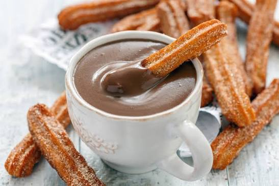
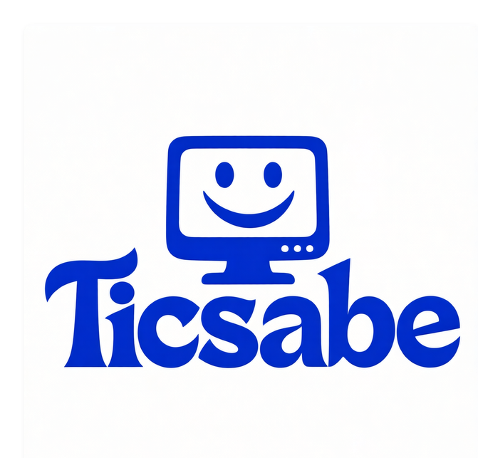

# BEBIDA PARA ACOMPAÑAR: chocolate con churros

 

## Ingredientes:
- Fariña (_a elegir_ )
- Auga
- Sal
- Aceite
- Chocolate ( _recomendación persoal: para fundir_ )
- Azúcar
- Leite
#### Nota: os churros **orixinais** NON levan azucre. 
### Agora falamos de cantidades.
---------
| Ingrediente  | Cantidade  | 
|----------|----------|
| FARIÑA   | 250 gr | 
| AUGA    | 250 ml   |  
| Aceote    | para frixir |  
| SAL    |   Unha pizca|
| CHOCOLATE  | 200 gr |
|LEITE | 500 ml|

> ### Preparación do noso prato.
`Segue os meus pasos:`

1. Fervemos o **auga** con sal, fariña e mesaturamos.
2. Introducimos a **masa** na churreira e freímos os churros no aceite ben quente
3. Espolvoreamos azucre _ao gusto_
4. **Quentamos** leite con chocolate ata que espese.
5. **Empratar:**

> ####  Nota da cociñeira Sabela:
Receta aproximada para **4 persoas** ~~non máis~~ 

[Visita a receta online](https://recetasdecocina.elmundo.es/2024/09/espaguetis-carbonara-receta-facil-casera.html)


[🏡](index.md)[🍝](pasta.md)
[🥚🥔](tortilla.md) [🍰](tarta.md)[🫗🍫](bebida.md)

`` 
Entra no meu blog
``


-[Ticsabe](https://ticsabe.wordpress.com/)


```
  Espero que che encante Bea!
