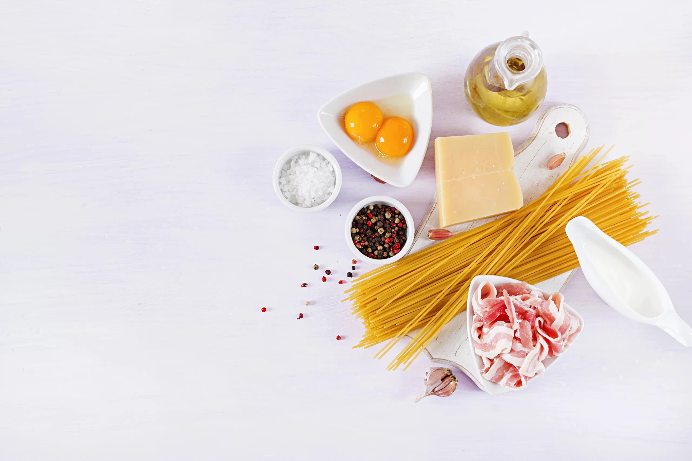

# PASTA CARBONARA



## Ingredientes:
- Pasta (_a elegir_ )
- Auga
- Guanciale
- Ovos
- Queixo ( _recomendación persoal: pecorino_ )
- Pementa
- Sal
#### Nota: a receta **orixinal** NON leva nata. 
### Agora falamos de cantidades.
---------
| Ingrediente  | Cantidade  | 
|----------|----------|
| PASTA   | 200 gr | 
| GUANCIALE    | 100 gr   |  
| OVO    | 1 enteiro e 3 xemas |  
| SAL    |   Unha pizca|
| QUEIXO  | 50 gr |
|Pementa | ao gusto|

> ### Preparación do noso prato.
`Segue os meus pasos:`

1. **Cocer a pasta:** Poñemos os espaguetis en auga fervendo con sal ata que estean al dente. Reservamos un pouco da auga de cocción.
2. **Preparar o guanciale:** Cortamos o guanciale en tiras ou dados e fritímolo nunha tixola ata que estea dourado e crocante.
3. **Preparar a crema:** Mesturamos nun bol as xemas de ovo (ou ovo enteiro), o pecorino relado e a pementa negra.
4. **Mesturar:** Engadimos os espaguetis á tixola co guanciale e mesturamos. Retiramos do lume e incorporamos a mestura de ovo e pecorino, engadindo un pouco de auga da pasta para conseguir unha salsa cremosa
5. **Empratar:** ervimos inmediatamente con máis pecorino e pementa negra por riba.

> ####  Nota da cociñeira Sabela:
Non engadir o ~~ovo~~ co lume **aceso** para evitar que calla e se converta en revolto. 

[Visita a receta online](https://recetasdecocina.elmundo.es/2024/09/espaguetis-carbonara-receta-facil-casera.html)


[🏡](index.md)[🍝](pasta.md)
[🥚🥔](tortilla.md) [🍰](tarta.md)[🫗🍫](bebida.md)

`` 
Entra no meu blog
``


-[Ticsabe](https://ticsabe.wordpress.com/)

```
  Espero que che encante Bea!


