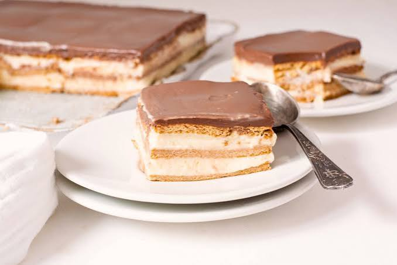

# TARTA DA AVOA



## Ingredientes:
- Galletas (_a elegir_ )
- Leite
- Chocolate
- Nata (_para montar_)
- Azucre 
#### Nota: propia da miña **avoa** as galletas, ademais de en leite, bótanse en anís 
### Agora falamos de cantidades.
---------
| Ingrediente  | Cantidade  | 
|----------|----------|
| GALLETAS   | 400 gr | 
| LEITE    | 750 ml   |  
| CHOCOLATE    | 300 gr|  
| NATA  |   400 ml|
| AZUCRE  | 80 gr |

> ### Preparación do noso prato.
`Segue os meus pasos:`

1. **Preparar as galletas** Quenta uns 250 ml de leite nun prato fondo. Molla as galletas no leite durante uns segundos, sen deixalas demasiado brandas
2. **Preparar a crema de chocolate:** Pon nun cazo 300 ml de nata e 50 g de azucre. Quenta a lume suave, sen deixar que ferva. Engade 200 g de chocolate troceado. Remexe ata conseguir unha crema homoxénea.
3. **Montar a tarta:** Coloca unha primeira capa de galletas molladas en leite no fondo dun molde. Engade unha capa de crema de chocolate. Coloca outra capa de galletas. Repite o proceso ata completar o molde, rematando cunha capa de chocolate.
4. **Preparar a cobertura:** Quenta os 100 ml de nata restantes. Engade os 100 g de chocolate restantes e remexe ata que se funda. Verte a mestura sobre a superficie da tarta.
5. **Arrefriar:** Deixa arrefriar a temperatura ambiente. Mete a tarta na neveira durante un mínimo de 4-6 horas. O ideal é deixala toda a noite.

> ####  Nota da cociñeira Sabela:
Para que quede máis **suave** e **cremosa** podes engadir un pouco máis de nata á crema de chocolate --. 

[Visita a receta online](https://www.directoalpaladar.com/postres/tarta-de-la-abuela-receta)

[🏡](index.md)[🍝](pasta.md)
[🥚🥔](tortilla.md) [🍰](tarta.md)[🫗🍫](bebida.md)

`` 
Entra no meu blog
``


-[Ticsabe](https://ticsabe.wordpress.com/)

```
  Espero que che encante Bea!