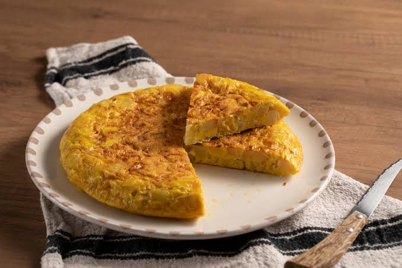

# Tortilla



## Ingredientes:
- Patatacas (_a elegir_ )
- Ovo
- Aceite
- Sal
- Cebola ( _recomendación persoal_ )
### Nota: a receta **orixinal** é coa tortilla MOI feita. 
### Agora falamos de cantidades.
---------
| Ingrediente  | Cantidade  |
|----------|----------|
| OVO   | 6 | 
| PATACA    | 5 medianas   |  
| CEBOLA    | 1 enteira |  
| ACEITE    |   _a ollo_|
| SAL  | ao gusto |

> ### Preparación do noso prato.
`Segue os meus pasos:`
1. **Preparar os ingredientes:** Pelamos as patacas e a cebola. Cortamos as patacas en láminas finas e a cebola en tiras.
2. **Fritir:** Fritimos as patacas e a cebola nunha tixola con aceite e un pouco de sal ata que estean brandas.
3. **Preparar o ovo:** Batemos os ovos nun bol e mesturámolos coas patacas e a cebola escorridas.
4. **Cociñar:** Botamos a mestura nunha tixola cun pouco de aceite e deixamos callar por un lado.
5. **Darlle a volta:** Coa axuda dun prato, dámoslle a volta e cociñámola polo outro lado ata conseguir o punto desexado.

> ####  Nota da cociñeira Sabela:
Non deixar ~~cocer~~ **demasiado** para evitar que quede seca. 

[Visita a receta online](https://recetasdecocina.elmundo.es/2024/09/tortilla-de-patatas-con-cebolla-receta-facil.html)


[🏡](index.md)[🍝](pasta.md)
[🥚🥔](tortilla.md) [🍰](tarta.md)[🫗🍫](bebida.md)

`` 
Entra no meu blog
``


-[Ticsabe](https://ticsabe.wordpress.com/)

```
  Espero que che encante Bea!